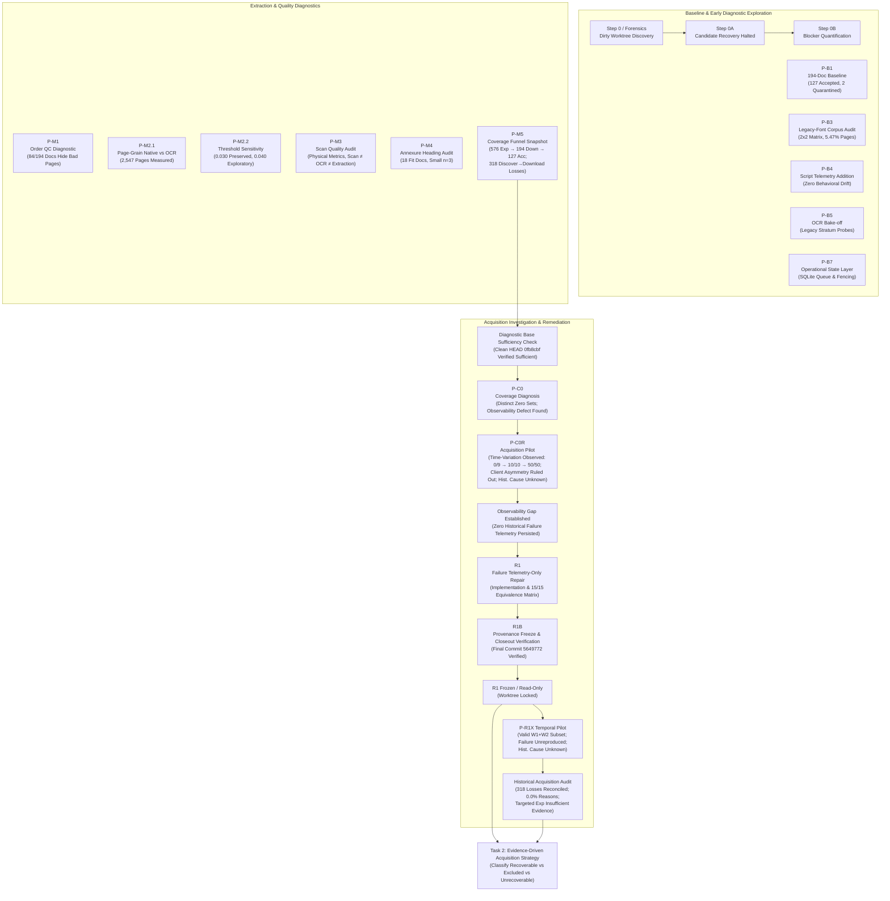

# ARPipe — Master Project Log

This document is the chronological and evidential master log for the ARPipe Master's thesis project. Every entry reflects verified findings from committed artifacts, frozen experiment reports, Git metadata, and direct forensic inspections.

---

## Chronological Trajectory

---

## 1. Baseline & Forensic Exploration

### Step 0 — Dirty-File Forensics & Concurrency Incident
- **Status:** HISTORICALLY ESTABLISHED
- **Workspace:** `D:\sem_iitk\sem9\thesis\sep_week1\arpipe-0.1.0` (evaluated in `arpipe-step0-forensics`)
- **Base HEAD:** `0fb8cbf6d932f4190bdfe3b2a1fecf62170cca14`
- **Key Findings:**
  - The primary shared working tree `arpipe-0.1.0` was contaminated by uncoordinated concurrent sessions.
  - 13 tracked files were modified across multiple interleaved streams (`P-B1`, `P-B2`, `P-B4`, `P-B5`, `P-B7`, `PM1`, `P18`, `P21`, `P22`, `P34`, `P-X2`, `P-X4`).
  - `reports/pattern_audit.md` suffered in-file corruption due to concurrent uncoordinated writes.
  - Baseline versions of modified files (`cli.py`, `pipeline.py`, `verify.py`) were not preserved as Git objects.
  - `arpipe/patterns.py` (Case B) was cleanly reverted to HEAD.

### Step 0A — Candidate Baseline Recovery Halted
- **Status:** BLOCKED / HISTORICALLY ESTABLISHED
- **Workspace:** `D:\sem_iitk\sem9\thesis\sep_week1\arpipe-step0a-recovery`
- **Verdict:** `BASELINE BLOCKED — ATTRIBUTION INCOMPLETE`
- **Proposed Candidate SHA:** `0d39395dfb81c987e05546471fbb80947c8fdce8` (stored in `arpipe-step0a-candidate`)
- **Accepted Canonical SHA:** `None`
- **Key Findings:**
  - Automated directory monitoring detected external mutation of `arpipe-0.1.0/.git/FETCH_HEAD` at `2026-09-17T12:47:21.122817+00:00`.
  - In strict compliance with worktree safety rules, execution halted immediately.
  - Enforced permanent rule: **ONE SESSION = ONE WORKTREE = ONE TASK**.

### Step 0B — Blocker Quantification & Recovery Audit
- **Status:** BLOCKED / HISTORICALLY ESTABLISHED
- **Workspace:** `D:\sem_iitk\sem9\thesis\sep_week1\arpipe-step0b-recovery`
- **Verdict:** `BASELINE BLOCKED — ATTRIBUTION INCOMPLETE`
- **Accepted Canonical SHA:** `None`
- **Key Findings:**
  - Re-verified that clean production baseline cannot be fabricated or inferred.
  - Reconciled known missing changes and established that forensic source state is partially unrecoverable.

---

## 2. Early Pipeline & Diagnostic Milestones

### P-B1 — Production Baseline & Windowed Language Gate
- **Status:** HISTORICALLY ESTABLISHED
- **Corpus Cardinality:** 194 verified PDF documents
- **Outcomes:** 182 MDA located, 127 accepted, 53 low quality, 12 failed, 2 quarantined.
- **Key Findings:**
  - Implemented the windowed wrong-language detector (`verify.looks_like_wrong_language`) checking `english_word_frac` against `ENGLISH_WORD_FRAC_MAX` and anomalous characters.
  - Quarantines 2 documents for language risk: `INE008A01015` FY2024 and FY2025.

### P-B3 — Legacy-Font Corpus Audit
- **Status:** HISTORICALLY ESTABLISHED
- **Report:** `reports/legacy_font_corpus_measurement.md`
- **Base SHA:** `0fb8cbf6d932f4190bdfe3b2a1fecf62170cca14`
- **Population:** 194 documents, 37,917 physical pages across 36 companies.
- **Key Findings:**
  - Constructed the 2×2 descriptive matrix for resolved pages:
    - Legacy font present & clean: 1,625 pages
    - Legacy font present & corrupted: 437 pages
    - No legacy font & corrupted: 826 pages
    - No legacy font & clean: 33,986 pages
    - Unresolved/unknown: 1,043 pages (Sum: 37,917)
  - Legacy font evidence present on 2,075 pages (5.47%), affecting 9 documents (4.64%) across 3 issuers.
  - Established critical conceptual distinction: **Legacy-font presence ≠ native text corruption**.

### P-B4 — Additive Script Telemetry
- **Status:** HISTORICALLY ESTABLISHED
- **Report:** `reports/pb4_corpus_validation.json`
- **Population:** 194 documents, 37,917 physical pages.
- **Key Findings:**
  - Added script telemetry (`dominant_script`, `devanagari_frac`, `english_word_frac`, `legacy_font_suspected`) without altering pipeline control flow.
  - Verified 100% behavioral invariance: 0 differences in document count, located count, page bounds, grades, or failure reasons.

### P-B5 — OCR Bake-off on Legacy Stratum
- **Status:** HISTORICALLY ESTABLISHED
- **Report:** `reports/ocr_bakeoff/results_summary.md`, `legacy_font_comparison.md`
- **Engines Tested:** `native_pdf`, `tesseract`, `paddleocr_vl`, `surya_2`, `gemini_flash_lite`.
- **Key Findings:**
  - Evaluated recovery of legacy Indian fonts (Devanagari encoded as Latin codepoints).
  - Diagnostic study only; no production engine change or threshold calibration occurred.

### P-B7 — Operational State Layer
- **Status:** HISTORICALLY ESTABLISHED
- **Documentation:** `arpipe/STATE.md`, `arpipe/state.py`
- **Key Findings:**
  - Built opt-in operational SQLite queue (`state.sqlite3`) with WAL mode, `synchronous=NORMAL`, and 30s busy timeout.
  - Implemented atomic claim leasing via `BEGIN IMMEDIATE` and `UPDATE ... RETURNING`.
  - Implemented lease fencing, heartbeat updates, and immediate cutoff at attempt 5 (`poison` status).

---

## 3. Extraction & Quality Diagnostics

### P-M1 — Per-Page Order QC Diagnostic
- **Status:** HISTORICALLY ESTABLISHED
- **Report:** `reports/pm1_per_page_orphan.md`
- **Branch:** `pm1-canonical` @ `c9d71bb127fcc46d690a8fbd9e5088b7049b6c05`
- **Key Findings:**
  - **84 of 194 documents have at least one page with `orphan_start_frac > 0.03` while their document-level score remains `<= 0.03`.**
  - Document-level aggregation conceals localized reading-order corruption.
  - Identified false-positive vulnerability in `is given below` pointer language (later addressed in P33).

### P-M2.1 — Native vs. OCR at True Page Grain
- **Status:** HISTORICALLY ESTABLISHED
- **Report:** `reports/pm2_pagegrain_native_vs_ocr.md`
- **Branch:** `pm2.1-pagegrain-native-vs-ocr` @ `158a9eac48a3374a9506af8281acb93f49a37a0d`
- **Population:** 182 located documents, 2,734 MD&A physical pages (2,412 measured native, 134 measured OCR, 1 unknown, 187 unmeasured due to <2 paragraphs).
- **Key Findings:**
  - Measured page-level `orphan_start_frac` across native vs. OCR populations.
  - Native fraction > 0.03: 25.17% (607/2,412 pages).
  - OCR fraction > 0.03: 41.79% (56/134 pages).
  - Noted high intra-document correlation: OCR pages represent only 21 independent documents.

### P-M2.2 — Exploratory Threshold Sensitivity Study
- **Status:** HISTORICALLY ESTABLISHED
- **Report:** `reports/pm2_2_threshold_study.md`
- **Branch:** `pm2.2-threshold-sensitivity` @ `6d91dfa8e8db4c9d570ba98dd234a228e4d3c57a`
- **Key Findings:**
  - Evaluated candidate thresholds `[0.020, 0.025, 0.030, 0.035, 0.040, 0.050, 0.060]`.
  - Production `ORPHAN_START_FRAC_MAX = 0.03` remained strictly unchanged.
  - `.040` identified as an exploratory candidate, pending gold label validation.

### P-M3 — Scan-Quality Measurement
- **Status:** HISTORICALLY ESTABLISHED
- **Report:** `reports/pm3_scan_quality.md`
- **Branch:** `pm3-scan-quality` @ `ec48e6454e278c789268519fe1f63d18374cd6b4`
- **Population:** 194 documents, 37,917 physical pages.
- **Key Findings:**
  - Full-page raster content found on 2,909 pages (7.67%).
  - Evaluated physical metrics: DPI, skew angle, contrast, noise/speckle, blur/sharpness.
  - Established methodological boundary: **Scan/input quality ≠ OCR quality ≠ extraction correctness ≠ OCR failure**.

### P-M4 — Annexure-Form Audit
- **Status:** HISTORICALLY ESTABLISHED
- **Report:** `reports/annexure_audit.md`
- **Branch:** `pm4-annexure-audit` @ `e387d6b8879d25af7b6d6946e28aaa635cb97165`
- **Population:** 18 eligible fit documents with verified true start (from 20 historical labelled fit docs).
- **Key Findings:**
  - Heading forms: 12 standalone heading (66.7%), 3 annexure-labelled (16.7%), 1 combined with directors' report (5.6%), 2 other (11.1%).
  - Extremely small annexure count ($n=3$) precludes strong causal or generalizable claims.

### P-M5 — Coverage Funnel Snapshot
- **Status:** HISTORICALLY ESTABLISHED
- **Report:** `reports/coverage.json`, `pm5_stage_table.csv`
- **Branch:** `pm5-coverage-funnel` @ `7292111149ab1cf9fc8d638d1f08023e3fcb13d5`
- **Population:** 576 expected company-years (36 companies × 16 fiscal years, FY2010–2025).
- **Funnel Counts:**
  1. EXPECTED: 576
  2. DISCOVERED: 512 (88.89% of expected)
  3. DOWNLOADED: 194 (33.68% of expected; 37.89% of discovered)
  4. IDENTITY_VERIFIED: 170 (29.51% of expected)
  5. MDA_LOCATED: 182 (31.60% of expected; non-monotonic with identity)
  6. ACCEPTED: 127 (22.05% of expected; headline coverage)
- **Key Findings:**
  - **The single largest loss in the entire pipeline is DISCOVERED → DOWNLOADED: 318 company-years lost (62.11% transition loss).**
  - All 194 successful downloads occurred on 2026-09-11 within a single ~4.5-minute window (10:28:44–10:33:08 UTC).
  - Reason codes for DISCOVERY and DOWNLOAD failures were 0.0% complete (unpersisted).

---

## 4. Acquisition Diagnosis & Observability Remediation

### Diagnostic Base Sufficiency Check
- **Status:** HISTORICALLY ESTABLISHED
- **Worktree:** `D:\sem_iitk\sem9\thesis\sep_week1\arpipe-pc0-diagnostic-base`
- **Base SHA:** `0fb8cbf6d932f4190bdfe3b2a1fecf62170cca14`
- **Verdict:** `DIAGNOSTIC BASE SUFFICIENT — P-C0 MAY START`
- **Key Findings:**
  - Verified that clean committed HEAD `0fb8cbf` plus frozen P-M5 evidence can support P-C0 without touching `arpipe-0.1.0`.
  - Preliminary network probe at ~13:17 UTC on 2026-09-17 failed 9/9 on `nsearchives.nseindia.com` (connection resets and 45s timeouts).

### P-C0 — Coverage Problem Diagnosis
- **Status:** HISTORICALLY ESTABLISHED
- **Report:** `reports/coverage_diagnosis.md`, `coverage_diagnosis.json`
- **Worktree:** `D:\sem_iitk\sem9\thesis\sep_week1\arpipe-pc0-coverage-diag`
- **Base SHA:** `0fb8cbf6d932f4190bdfe3b2a1fecf62170cca14`
- **Verdict:** `COVERAGE MECHANISM PARTIALLY IDENTIFIED — FURTHER EVIDENCE REQUIRED`
- **Key Findings:**
  - Strictly distinguished three nested zero-coverage fiscal-year sets:
    - `downloaded = 0` (8 FYs: 2010, 2014, 2016, 2019, 2020, 2021, 2022, 2023)
    - `mda_located = 0` (9 FYs: `downloaded=0` + FY2015)
    - `accepted = 0` (10 FYs: `mda_located=0` + FY2011)
  - Ruled out `cohort_fetch_manifest.jsonl` (194 rows) as a pre-fetch filter (proven to be a post-hoc store export).
  - Ruled out file-format / corruption causes (probed URLs returned valid ZIP/PDF payloads).
  - Observed endpoint accessibility reversal: 10/10 sampled URLs succeeded at ~13:59 UTC, reversing the 0/9 failure seen at ~13:17 UTC.
  - Confirmed critical observability defect: `fetch_one` printed failures to stderr or silently returned `None` on exhausted 403/429/503; zero failure records were persisted.

### P-C0R — Instrumented Acquisition Pilot
- **Status:** HISTORICALLY ESTABLISHED / CURRENTLY REPRODUCED
- **Report:** `reports/pc0r_diagnosis.md`, `pc0r_diagnosis.json`
- **Worktree:** `D:\sem_iitk\sem9\thesis\sep_week1\arpipe-pc0r-acquisition-pilot`
- **Branch:** `pc0r-acquisition-pilot` @ `0fb8cbf6d932f4190bdfe3b2a1fecf62170cca14`
- **Verdict:** `NO REPRODUCIBLE CURRENT FAILURE — HISTORICAL CAUSE REMAINS UNKNOWN`
- **Contextual Verdict:** `CURRENT ACCESS VARIATION OBSERVED — HISTORICAL CAUSE NOT PROVEN`
- **Key Findings:**
  - Repeated-arm testing (30 probes across T+0, T+20, T+40 min): 30/30 succeeded (100%).
  - Controlled A/B client comparison (10 pairs, alternating order): 10/10 pairs succeeded equally with Arm A (cookies + headers) and Arm B (fetch client, unseeded).
  - **Client configuration asymmetry ruled out as a current failure cause.**
  - Failure did not reproduce during the 14:40–15:21 UTC window.
  - **Historical cause on 2026-09-11 remains strictly UNKNOWN** because historical execution was never persisted.

### R1 — Acquisition Failure Telemetry-Only Repair
- **Status:** HISTORICALLY ESTABLISHED / VERIFIED COMPLETE
- **Report:** `reports/r1_fetch_telemetry.md`, `reports/r1_fetch_telemetry.json`
- **Authoritative Telemetry:** `reports/r1_telemetry/r1_matrix_telemetry.jsonl`
- **Worktree:** `D:\sem_iitk\sem9\thesis\sep_week1\arpipe-r1-fetch-telemetry`
- **Branch:** `r1-fetch-telemetry`
- **Base SHA:** `0fb8cbf6d932f4190bdfe3b2a1fecf62170cca14`
- **Verdict:** `FAILURE TELEMETRY REPAIR COMPLETE — BEHAVIOR UNCHANGED`
- **Key Findings:**
  - Implemented `arpipe/telemetry.py` with schema version `r1-v1`.
  - Added non-blocking failure emission in `arpipe/fetch.py` and `--telemetry-path` in `arpipe/cli.py`.
  - Emits exactly one JSONL record per actual HTTP/network attempt.
  - Writer failure guarantee verified: errors (`PermissionError`, `OSError(28)`, `RuntimeError`) are completely absorbed without altering control flow.
  - Preserved exact pre-R1 silent fall-through behavior on exhausted 403/429/503 retries.
  - Tested PRE-vs-POST equivalence: 15/15 tests passed.
  - Verified P33 benchmark: passed.
  - Verified regression suite (`test_discover.py`, `test_config.py`, `test_r1_fetch_telemetry.py`): 31/31 passed.
  - Verified `arpipe/patterns.py`: 0 diff, completely clean.

### R1B — R1 Provenance Verification & Final Freeze Closeout
- **Date:** 2026-09-17
- **Worktree:** `D:\sem_iitk\sem9\thesis\sep_week1\arpipe-r1-fetch-telemetry` (Marked: **FROZEN / READ-ONLY**)
- **Branch:** `r1-fetch-telemetry`
- **Base SHA:** `0fb8cbf6d932f4190bdfe3b2a1fecf62170cca14`
- **Final Commit SHA:** `56497721cb68c4831e6f225074b6bd7ea17bffb0`
- **Commit Message:** `R1: add acquisition failure telemetry without behavior change`
- **Objective:** Finalize, verify, and freeze the R1 telemetry implementation into an immutable Git commit, catalog all artifact hashes, classify test evidence, and close out the R1 milestone without performing any new engineering work.
- **R1 Result:** `FROZEN / COMMITTED`
  - 9 committed files (1,853 insertions, 3 deletions): `arpipe/cli.py`, `arpipe/fetch.py`, `arpipe/telemetry.py`, `arpipe/tests/test_r1_fetch_telemetry.py`, `reports/r1_fetch_telemetry.json`, `reports/r1_fetch_telemetry.md`, `reports/r1_telemetry/r1_generation_summary.json`, `reports/r1_telemetry/r1_matrix_telemetry.jsonl`, `tools/generate_r1_telemetry.py`.
  - Bitwise 0 diff on core regex patterns (`arpipe/patterns.py`).
  - Untracked directories `reports/r1_telemetry/scratch_store/` and `scratch/` cleanly isolated.
  - Production `main` remains untouched at `0fb8cbf`.
- **Test Evidence Classification:**
  - **PREVIOUSLY EXECUTED:** 15/15 behavioral equivalence fixtures, P33 benchmark, and 31/31 regression tests were executed during R1 engineering run using external environment `D:\sem_iitk\sem9\thesis\sep_week1\arpipe-pm2.1-pagegrain\.venv` (Python 3.14.3, pytest 9.1.1).
  - **CURRENT LOCAL TEST STATUS:** The local virtual environment `D:\sem_iitk\sem9\thesis\sep_week1\arpipe-r1-fetch-telemetry\.venv` has verified identical dependency versions (Python 3.14.3, pytest 9.1.1, httpx 0.28.1, etc.). In accordance with closeout freeze rules, tests were not re-executed in the local venv during closeout; tests remain classified as PREVIOUSLY EXECUTED and are NOT marked as CURRENTLY REPRODUCED in local closeout.
- **Artifact Evidence (Cryptographic SHA-256 Hashes):**
  - `arpipe/telemetry.py`: `667dc9c6f2e282d6c2ded859aeb7b4c7b61b49142d041f744c25cf3ae2ba9ca4`
  - `arpipe/fetch.py`: `2b20a66878e23c3ded5e86f8bd3dc756022f356b01b238a1b4d96ffef084db3f`
  - `arpipe/cli.py`: `df5e4bf43ef3266fd8b3f8b33ddc2eb93f4fe46d068d390c5f0d9a9a528c5149`
  - `arpipe/tests/test_r1_fetch_telemetry.py`: `ef9a609cec3d2b4751d9c7482dee070c5a50cf1fc0e4cf4ef00f891c880fce47`
  - `tools/generate_r1_telemetry.py`: `e09191818755c8eba4f8a169a3b335d99ebf10f8c18d3468d68de341cde40e67`
  - `reports/r1_fetch_telemetry.md`: `edf26f03a433e1e344c956195c1cab605b519dc3aec62a4e142a0dbbf48a895c`
  - `reports/r1_fetch_telemetry.json`: `10310bd9cce4f55b198a7e6f5777e7c86d3ecce029f068003e750623fc6d26ab`
  - `reports/r1_telemetry/r1_matrix_telemetry.jsonl`: `466dca2953cea16b698fe81dec2ef852634c4b6e5a476acb831033b941a90631`
  - `reports/r1_telemetry/r1_generation_summary.json`: `92e2dc8e4a82eec021dd1c91684b9b04ab51a42367cf5a6099a8e200135dce05`
- **Key Decisions:**
  - Worktree `arpipe-r1-fetch-telemetry` is permanently **FROZEN / READ-ONLY**.
  - All future acquisition tasks must execute in a NEW dedicated worktree branched from final R1 commit `56497721cb68c4831e6f225074b6bd7ea17bffb0`.
  - Zero algorithmic, retry, timing, or header alterations were made (telemetry-only mandate preserved).
- **Limitations & Epistemological Boundaries:**
  - Historical 2026-09-11 failure causality remains strictly **UNKNOWN**.
  - R1 telemetry does not prove the historical failure distribution or whether NSE CDN throttling was the historical driver.
  - Telemetry has only been verified against synthetic and mock matrix fixtures; live probe telemetry against un-downloaded cohort remains to be captured.
- **Next Phase:**
  - `POST-R1 ACQUISITION DIAGNOSIS / ACQUISITION RESOLUTION` in a NEW dedicated worktree based on commit `56497721cb68c4831e6f225074b6bd7ea17bffb0`.

### R1 Frozen — Local Environment Reproduction, Final Validation, Freeze & Commit
- **Date:** 2026-09-17
- **Task:** R1B Local Reproduction, Final Validation, Freeze & Commit
- **Objective:** Reproduce deterministic R1 tests inside the dedicated R1 worktree environment (`arpipe-r1-fetch-telemetry\.venv`), verify behavioral scope invariance, verify report artifact integrity without replacement, freeze verified state with exactly ONE commit, and verify the final commit.
- **Result:** `R1 IMPLEMENTATION FROZEN — CURRENT LOCAL TESTS REPRODUCED`
- **Final Commit SHA:** `56497721cb68c4831e6f225074b6bd7ea17bffb0`
- **Commit Message:** `R1: add acquisition failure telemetry without behavior change`
- **Base SHA:** `0fb8cbf6d932f4190bdfe3b2a1fecf62170cca14` (lineage confirmed, exactly 1 commit ahead)
- **Branch:** `r1-fetch-telemetry` in `D:\sem_iitk\sem9\thesis\sep_week1\arpipe-r1-fetch-telemetry`
- **Committed Files (9):** `arpipe/cli.py`, `arpipe/fetch.py`, `arpipe/telemetry.py`, `arpipe/tests/test_r1_fetch_telemetry.py`, `reports/r1_fetch_telemetry.json`, `reports/r1_fetch_telemetry.md`, `reports/r1_telemetry/r1_generation_summary.json`, `reports/r1_telemetry/r1_matrix_telemetry.jsonl`, `tools/generate_r1_telemetry.py`.
- **Patterns Invariance:** `git diff -- arpipe/patterns.py` verified with 0 diff.
- **Local Test Evidence (Dedicated R1 `.venv`):**
  - Executed strictly using `D:\sem_iitk\sem9\thesis\sep_week1\arpipe-r1-fetch-telemetry\.venv\Scripts\python.exe`
  - Test A (P33): `python -m pytest -p no:cacheprovider arpipe/tests/test_pipeline.py -k "test_p33_is_given_below_not_pointer"` $\rightarrow$ 1 passed, 84 deselected (`CURRENTLY REPRODUCED`)
  - Test B (R1 failure telemetry): `python -m pytest -v -p no:cacheprovider arpipe/tests/test_r1_fetch_telemetry.py` $\rightarrow$ 15 passed, 0 failed (`CURRENTLY REPRODUCED`)
  - Test C (discover/config regression): `python -m pytest -v -p no:cacheprovider arpipe/tests/test_discover.py arpipe/tests/test_config.py` $\rightarrow$ 16 passed, 0 failed (`CURRENTLY REPRODUCED`)
  - Total local tests: 32 passed, 0 failed, 0 skipped (`CURRENTLY REPRODUCED`)
  - Historical external tests in `arpipe-pm2.1-pagegrain\.venv` remain separately classified as `PREVIOUSLY EXECUTED`.
  - Environment equivalence: Python 3.14.3 and matching package versions establish equivalence for bounded R1 tests (does not claim bitwise full-environment identity).
- **Committed Artifact Evidence (Cryptographic SHA-256 Hashes):**
  - `reports/r1_fetch_telemetry.md`: `edf26f03a433e1e344c956195c1cab605b519dc3aec62a4e142a0dbbf48a895c`
  - `reports/r1_fetch_telemetry.json`: `10310bd9cce4f55b198a7e6f5777e7c86d3ecce029f068003e750623fc6d26ab`
  - `reports/r1_telemetry/r1_matrix_telemetry.jsonl`: `466dca2953cea16b698fe81dec2ef852634c4b6e5a476acb831033b941a90631`
  - `reports/r1_telemetry/r1_generation_summary.json`: `92e2dc8e4a82eec021dd1c91684b9b04ab51a42367cf5a6099a8e200135dce05`
  - `walkthrough.md`: MISSING / intentionally not recreated.
- **Key Decisions:**
  - `D:\sem_iitk\sem9\thesis\sep_week1\arpipe-r1-fetch-telemetry` is permanently **FROZEN / READ-ONLY**.
  - All future engineering tasks must use a NEW dedicated worktree branched from commit `56497721cb68c4831e6f225074b6bd7ea17bffb0`.
  - Next acquisition intervention must be selected only after analyzing R1 telemetry; no repair mechanism is chosen in advance.
- **Limitations & Epistemological Boundaries:**
  - Historical cause of the 318 discovered $\rightarrow$ downloaded losses on 2026-09-11 remains strictly **UNKNOWN**.
  - R1 adds failure observability; it does not establish the historical cause of acquisition loss.
- **Next Phase:**
  - `POST-R1 ACQUISITION DIAGNOSIS / ACQUISITION RESOLUTION`: Analyze R1 telemetry and determine the smallest evidence-supported acquisition-resolution experiment in a NEW dedicated worktree.

---

## 2026-09-17: R1 Telemetry Analysis & P-R1X Protocol Freeze
- **Status:** `COMPLETE / FROZEN ANALYSIS`
- **Analysis Worktree:** `D:\sem_iitk\sem9\thesis\sep_week1\arpipe-r1-telemetry-analysis` (branch `r1-telemetry-analysis`)
- **Analysis Commit:** `3beee249db36f9fdd1a8a2e01d6fdc3c6024d870`
- **Engineering Base SHA:** `56497721cb68c4831e6f225074b6bd7ea17bffb0` (Frozen R1 implementation)
- **Objective:** Analyze frozen R1 telemetry artifacts, classify controlled vs live evidence, enforce statistical restrictions, reconcile with historical findings (P-M5, P-C0, P-C0R), identify information gaps, evaluate production change justification, and design the smallest evidence-supported acquisition-resolution experiment (P-R1X).
- **Verdict:** `TELEMETRY ANALYSIS COMPLETE — NEXT EXPERIMENT SPECIFIED`
- **Evidence Produced:**
  - `reports/r1_telemetry_analysis.md` (Committed in `3beee249`)
  - `reports/r1_telemetry_analysis.json` (Committed in `3beee249`)
- **Key Findings:**
  1. *Controlled Telemetry Characterization:* R1 test matrix emitted 17 records across 9 fixtures (21 simulated requests); 7 terminal, 10 retriable, 5 retry-exhausted, 2 validation aborts; writer exceptions swallowed without altering returns.
  2. *Statistical Restriction Enforced:* Synthetic test matrix is a code-path fixture, not a random population sample. Population-level failure estimates, rates, and distributions must never be derived from it.
  3. *Historical-vs-Current Distinction:* The historical cause of the 2026-09-11 acquisition losses cannot be established from the surviving evidence (0.0% reason codes, silent fall-through, unpersisted stderr logs). Contemporary temporal variation is CURRENTLY REPRODUCED (outcomes differed across observed windows; no periodic schedule established).
  4. *Remaining Hypotheses:* H1 (Transport collapse: PLAUSIBLE BUT UNPROVEN), H2 (Rate limiting: PLAUSIBLE BUT UNPROVEN), H3 (Temporal access variation: CURRENTLY REPRODUCED), H4 (URL-specific defects: PLAUSIBLE BUT UNPROVEN), H5 (Historical invocation gap: PLAUSIBLE BUT UNPROVEN).
  5. *Information Gap:* Lack of attempt-level layer-classified telemetry collected during live acquisition on candidate un-downloaded URLs under controlled temporal and pacing conditions.
  6. *Production-Change Decision:* `INSUFFICIENT EVIDENCE`. Changing retry policies, backoffs, timeouts, or headers before collecting live diagnostic telemetry is unjustified and speculative.
- **Protocol Frozen:** `P-R1X — Instrumented Acquisition Telemetry Pilot` (`protocols/P-R1X.md`)
  - Population: Census of frozen P-C0 sample ($N=10$; 5 zero FY targets + 5 controls from `reports/pc0_sample_manifest.json`).
  - Independent Variable: 3 pre-scheduled temporal observation windows ($T_0$, $T_0 + 30$m, $T_0 + 60$m).
  - Controlled Variables: Frozen R1 implementation, standard client, polite pacing ($\ge 2.0$s), frozen retry policy.
  - Engineering Base: Must branch strictly from `56497721cb68c4831e6f225074b6bd7ea17bffb0`.
- **Limitations:**
  - Historical 2026-09-11 failure distribution cannot be retroactively established.
  - Unsampled zero-download fiscal years (FY2019, FY2020, FY2023) remain unprobed.
  - Polite pacing cannot evaluate origin behavior under high-concurrency burst loads.
- **Next Dependency:**
  - Execute frozen P-R1X protocol in a NEW dedicated worktree created from base `56497721cb68c4831e6f225074b6bd7ea17bffb0`.

---

## 2026-09-18: P-R1X Forensic Adjudication & Memory Closeout
- **Status:** `ADJUDICATED / CLOSED OUT`
- **Experimental Status:** `INCOMPLETE AS A THREE-WINDOW TEMPORAL EXPERIMENT (VALID TWO-WINDOW PRIMARY SUBSET + POST-INTERRUPTION SUPPLEMENTAL DATA)`
- **Protocol Version:** `P-R1X v1.2`
- **Engineering Base SHA:** `56497721cb68c4831e6f225074b6bd7ea17bffb0`
- **Execution Worktree:** `D:\sem_iitk\sem9\thesis\sep_week1\arpipe-pr1x-execution` (branch `pr1x-execution`)
- **Execution Commit SHA:** `0b1d595407eacb13b115811cdb610b3e1f56a767` (`P-R1X: execute instrumented acquisition telemetry pilot`)
- **Adjudication Worktree:** `D:\sem_iitk\sem9\thesis\sep_week1\arpipe-pr1x-adjudication` (branch `pr1x-adjudication`)
- **Adjudication Commit SHA:** `ca92b8e8d043cccb9556a6fc591927b3bbf1cf32` (`P-R1X: adjudicate interrupted temporal pilot`)
- **Run ID:** `5e675cbec11647819858e673b9a95ab6`
- **Candidate Sample:** $N = 10$ observations (5 targets with historical `downloaded=False`, 5 controls with historical `downloaded=True`) from `reports/pc0_sample_manifest.json` (SHA-256: `394c628d842bdcf967b6dd82ab695fb4b17a88602c7c79c0b17561a3d931bb0e`).
- **Forensic Adjudication Findings:**
  1. *Window 1:* **VALID** (Scheduled: 2026-09-17 20:05:00 UTC; Actual Start: 20:05:00.001 UTC; delay +1.4ms; 10/10 `SUCCESS_STORED_DOC` on attempt 1; HTTP 200; 0 retries; sequential single worker; primary analysis eligible).
  2. *Window 2:* **VALID** (Scheduled: 2026-09-17 21:35:00 UTC; Actual Start: 21:35:00.002 UTC; delay +2.1ms; 10/10 `SUCCESS_STORED_DOC` on attempt 1; HTTP 200; 0 retries; sequential single worker; primary analysis eligible).
  3. *Window 3:* **POST_INTERRUPTION_SUPPLEMENTAL** (Scheduled: 2026-09-17 23:05:00 UTC; Actual Start: 2026-09-18 08:17:46.015 UTC; delayed by **9 hours, 12 minutes, 46 seconds** due to host sleep / process suspension during inter-window wait loop; 10/10 `SUCCESS_STORED_DOC` on attempt 1).
  4. *Governing Interruption Rule:* Runbook Section 10 strictly prohibits substituting timestamps or continuing under changed execution state. Window 3 missed its scheduled temporal window and is excluded from primary temporal comparison. Observations are preserved as supplemental evidence.
  5. *Primary Analysis Sample:* Exactly 20 observations across valid Windows 1 and 2 (10 target, 10 control). Target success: 10/10 (100%). Control success: 10/10 (100%). Target vs Control difference: 0.0%.
  6. *Supplemental Sample:* Exactly 10 observations from post-interruption Window 3 (5 target, 5 control). All 10/10 succeeded.
  7. *Bitwise Payload Reproducibility:* 10/10 document blobs across all runs yielded bitwise-identical SHA-256 CAS hashes.
  8. *Directly Observed Results:* Current endpoints are viable, unadorned `httpx.Client` succeeds, and `HostLimiter` 1.5s pacing is accepted without rate limits or IP bans. The historical acquisition failure mode was **NOT OBSERVED** and **NOT REPRODUCED** on this pilot sample under test conditions.
  9. *Historical Causality:* **UNKNOWN / NOT ESTABLISHED**. Current access viability does not reveal why 318 documents failed to download on 2026-09-11.
  10. *Future Repair-Experiment Decision:* **INSUFFICIENT EVIDENCE**. Baseline acquisition succeeded completely on this sample; the historical failure was not reproduced; no active failure signal exists to repair; and designing an acquisition repair without reproducing the failure would be unguided speculation. This does not mean the problem is solved.
  11. *Overclaims Corrected:* Existing execution summary claims of "COMPLETED — ALL 3 WINDOWS EXECUTED", "zero variance across three windows", and "30/30 scheduled acquisitions" are corrected to reflect the valid two-window temporal subset and post-interruption supplemental data.
- **Next Project Task:**
  - `HISTORICAL ACQUISITION-CAUSE EVIDENCE AUDIT`: Audit surviving historical artifacts from 2026-09-11 (logs, manifests, fetch records, HTTP traces) to determine the historical failure layer before contemplating any engineering repair.

---

## 2026-09-18: Historical Acquisition-Cause Evidence Audit
- **Status:** `COMPLETE / ADJUDICATED HISTORICAL BASELINE`
- **Investigation Mode:** `LOCAL / OFFLINE READ-ONLY HISTORICAL FORENSICS`
- **Worktree:** `D:\sem_iitk\sem9\thesis\sep_week1\arpipe-pr1x-historical-audit` (branch `pr1x-historical-audit`)
- **Base Commit SHA:** `ca92b8e8d043cccb9556a6fc591927b3bbf1cf32` (P-R1X forensic adjudication commit)
- **Commit SHA:** `1b6fd1f496b3634ee57bef6b926f7a79524c1cac` (`Historical audit: classify 2026-09-11 acquisition losses`)
- **Objective:** Reconcile the authoritative 318 historical loss population from surviving 2026-09-11 artifacts, audit historical telemetry completeness, evaluate request invocation state, evaluate 11 failure mechanisms, answer all 17 required analytical questions, and render a binding next-experiment decision.
- **Verdict:** `POPULATION RECONCILED (318/318) — HISTORICAL MECHANISMS UNKNOWN (0.0% REASONS PERSISTED) — INSUFFICIENT HISTORICAL EVIDENCE FOR TARGETED EXPERIMENT`
- **Committed Deliverables (8):**
  1. `reports/historical_loss_ledger.csv` (SHA-256: `95ba4a51...`, 318 loss rows, 100% locator references)
  2. `reports/historical_evidence_register.csv` (SHA-256: `f5ee229c...`, 10 audited evidence items EV-HIST-01 to EV-HIST-10)
  3. `reports/historical_configuration_snapshot.json` (SHA-256: `a91f8fb5...`, committed client parameters vs unrecorded runtime flags)
  4. `reports/historical_hypothesis_matrix.csv` (SHA-256: `8938c5f5...`, 11 evaluated failure mechanisms)
  5. `reports/historical_git_timeline.md` (SHA-256: `a3ff2f59...`, Sep 10–18 repository chronology)
  6. `reports/historical_acquisition_cause_audit.json` (SHA-256: `a0f7dbb6...`, comprehensive machine-readable findings)
  7. `reports/historical_acquisition_cause_audit.md` (SHA-256: `0a0349ca...`, full 11-section forensic report)
  8. `reports/historical_audit_hashes.json` (SHA-256: `ea2cb555...`, pre vs post cryptographic verification across all 29 sources)
- **Cryptographic Chain of Custody:**
  - 29 historical source artifacts inspected across 7 worktrees/directories.
  - Verification: `pre_hash == post_hash` across 100% of inspected sources (29 of 29 files unchanged).
  - Source integrity status: `ALL_SOURCE_HASHES_PRESERVED_UNCOMPROMISED`.
- **Key Forensic Findings:**
  1. *Population Identity Reconciliation: EXACT (318 of 318).* Reconstructed directly from `reports/pm5_stage_table.csv` and cross-referenced to `cohort_reports.jsonl`. 318 unique observations, 0 duplicates, 0 missing, 0 invented. Reconciles: 576 expected - 64 undiscovered = 512 discovered - 194 downloaded = exactly 318 losses.
  2. *Historical Reason-Code Completeness: EXACTLY 0.0% (0 of 318).* Zero HTTP status codes, socket exceptions, or retry traces survive for the 318 losses (`pm5_reason_code_completeness.csv` = 0.0%). All 318 are recorded as `REASON_CODE_MISSING`.
  3. *Request Invocation State: `REQUEST_NOT_CONFIRMED`.* In accordance with mandatory epistemic rule `NO_REQUEST_EVIDENCE != REQUEST_DID_NOT_OCCUR`, candidate URLs were discovered, but no record confirms whether HTTP requests were actually dispatched for the 318 losses.
  4. *The Silent Drop Path:* In pre-R1 `arpipe/fetch.py:fetch_one()`, encountering 403/429/503 across all 3 retries executed `time.sleep()` and `continue` without setting `last_err`, silently executing `return None` with zero stderr prints and zero disk records.
  5. *Intermediate Manifest Discovery:* `cohort_fetch_manifest.jsonl` was written at 10:28:22 UTC on 2026-09-11 (22 seconds before first download began at 10:28:44 UTC) containing 460 rows covering **exactly the 194 successful pairs** and **omitting all 318 losses**. Whether it served as an input filter or was exported post-hoc cannot be proven due to absence of shell transcripts (`PLAUSIBLE_BUT_UNPROVEN`).
  6. *Hypotheses Ruled Out:* Payload corruption (ruled out on tested sample: 100% valid ZIP/PDF with matching magic bytes and CAS hashes); URL malformation (ruled out: all 318 have valid regulatory paths); client configuration asymmetry (ruled out as technical barrier: P-C0R proved 10/10 paired success; P-R1X succeeded 20/20 unadorned).
  7. *Hypotheses Plausible but Unproven:* Upstream CDN rate-limiting/resets; workflow invocation gap; silent drop on 403/429/503; concurrency burst triggering origin bot defenses; retry exhaustion.
- **Next-Experiment Decision:**
  - **Verdict:** **`INSUFFICIENT HISTORICAL EVIDENCE FOR TARGETED EXPERIMENT`**
  - **Rationale:** A targeted repair or reproduction experiment claiming to test a specific historical failure mechanism cannot be designed without unguided speculation and invention of unrecorded historical facts.
- **Next Project Task:**
  - **Task Identifier:** `Task 2 (Evidence-Driven Acquisition Strategy: Classify Recoverable vs. Excluded vs. Unrecoverable)`
  - **Task Nature:** `INFORMATION-GAP / OBSERVABILITY TASK`
  - **Objective:** Deploy structured R1 attempt-level telemetry across the full 318 un-downloaded cohort to systematically categorize each company-year into: Category A (Recoverable Technical Gaps), Category B (Systematic URL/Parser Defects), or Category C (Genuine Archival Unavailability).

