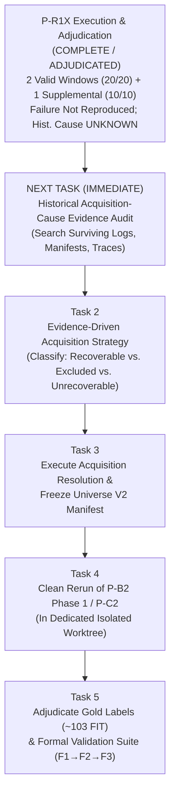

# ARPipe — Next Tasks and Implementation Roadmap

This document defines the prioritized task sequence for the ARPipe thesis project, beginning with the immediate post-R1 diagnostic step.

---

## Task Roadmap Overview

---

## NEXT TASK: Historical Acquisition-Cause Evidence Audit

- **Task Identifier:** `HISTORICAL-AUDIT`
- **Objective:** Search surviving historical artifacts across the thesis repository and historical run directories for evidence that can classify the 2026-09-11 discovered $\rightarrow$ downloaded losses (318 lost documents).
- **Search Targets:**
  1. Historical run logs and stdout/stderr dumps
  2. Historical discovery manifests and URL inventories
  3. Historical fetch logs, cache files, and store logs
  4. Prior telemetry files and timestamped outputs
  5. HTTP status code records, headers, or server responses
  6. Python exception traces and crash logs
  7. Preserved run summaries, reports, and command logs
  8. Historical experiment artifacts across `sep_week1` and `thesis` root
- **Methodological Priority:** **Historical evidence FIRST.**
  - Do NOT jump directly to an acquisition repair.
  - Do NOT infer the historical cause from current pilot success.
  - If sufficient evidence exists: design the next diagnostic or resolution experiment directly from the identified failure evidence.
  - If insufficient evidence exists: explicitly record the empirical information gap in project memory.
- **Operating Mode:** Read-only historical investigation. No live network requests. No production code modifications.
- **Reference Artifacts & Hashes:**
  - P-R1X Adjudication Report: `reports/pr1x_adjudication.md`
  - P-R1X Adjudication SHA: `ca92b8e8d043cccb9556a6fc591927b3bbf1cf32`
  - Original 10-Obs Manifest: `reports/pc0_sample_manifest.json` (SHA: `394c628d...`)
  - Historical Stage Table: `reports/pm5_stage_table.csv` (SHA: `30e93b59...`)

---

## Task 2: Evidence-Driven Acquisition Strategy

- **Objective:** Analyze comprehensive telemetry to classify all 318 un-downloaded company-years into three definitive categories:
  1. **Category A (Recoverable Technical Gaps):** Missing documents that succeed under appropriate network pacing, unblocked windows, or minimal verified adjustments.
  2. **Category B (Systematic URL / Parser Defects):** Discovered URLs with malformed paths or misidentified formats requiring targeted corrections.
  3. **Category C (Genuine Archival Unavailability):** Company-years that do not exist at source (e.g. pre-incorporation, corporate reorganization, missing filings on exchange archives).
- **Deliverable:** Formal Acquisition Resolution Plan pre-registering which company-years will be re-fetched vs. which will be excluded with frozen rationale.

---

## Task 3: Execute Acquisition Resolution & Freeze Universe V2

- **Objective:** Execute the authorized acquisition repair in a dedicated worktree and freeze the final target dataset (Universe V2).
- **Actions:**
  1. Execute re-acquisition for Category A and Category B observations.
  2. Document frozen exclusion rules for Category C observations.
  3. Generate `universe_v2_manifest.jsonl` with cryptographic SHA-256 hashes.
  4. Verify population accounting: `Total Universe V2 = Acquired + Documented Exclusions`.

---

## Task 4: Clean Rerun of P-B2 Phase 1 / P-C2

- **Objective:** Cleanly re-execute P-B2 Phase 1 (candidate body script measurement) and P-C2 (core pipeline validation) in an isolated worktree.
- **Prerequisite:** Universe V2 frozen (Task 3).
- **Rationale:** The original P-B2 Phase 1 run was contaminated by concurrent edits in the shared `arpipe-0.1.0` worktree, leaving baseline versions of `cli.py`, `pipeline.py`, and `verify.py` unrecoverable as Git objects.
- **Model Allocation:** Opus 5 XHigh / Max

---

## Task 5: Gold Standard Adjudication & Formal Validation Suite (F1 $\rightarrow$ F2 $\rightarrow$ F3)

- **Objective:** Adjudicate human ground-truth labels for the ~103 FIT dataset documents and execute the three-stage formal validation suite:
  - **F1 (In-Sample Fit Evaluation):** Verify pipeline extraction accuracy against gold FIT labels.
  - **F2 (Holdout Generalization):** Evaluate against frozen holdout partition without retraining or threshold adjustment.
  - **F3 (Reserve / Stress Testing):** Stress test against difficult edge cases (scan quality, legacy fonts, bilingual text).
- **Deliverable:** Final thesis extraction accuracy and coverage figures.
