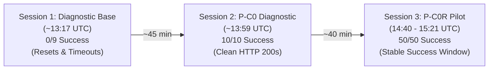

# P-C0R — Instrumented Acquisition Resolution Pilot

**Status:** HISTORICALLY ESTABLISHED / CURRENTLY REPRODUCED  
**Branch:** `pc0r-acquisition-pilot` @ `0fb8cbf6d932f4190bdfe3b2a1fecf62170cca14`  
**Worktree:** `D:\sem_iitk\sem9\thesis\sep_week1\arpipe-pc0r-acquisition-pilot`  
**Primary Report:** [`reports/pc0r_diagnosis.md`](file:///D:/sem_iitk/sem9/thesis/sep_week1/arpipe-pc0r-acquisition-pilot/reports/pc0r_diagnosis.md)  
**Companion Data:** `reports/pc0r_diagnosis.json`, `reports/pc0r_attempt_log.csv`, `reports/pc0r_client_comparison.csv`  
**Primary Verdict:** `NO REPRODUCIBLE CURRENT FAILURE — HISTORICAL CAUSE REMAINS UNKNOWN`  
**Contextual Verdict:** `CURRENT ACCESS VARIATION OBSERVED — HISTORICAL CAUSE NOT PROVEN`

---

## 1. Experimental Design & Pre-Registered Structure
Designed to test whether the acquisition failures observed at ~13:17 UTC reproduce under controlled conditions, and whether client configuration asymmetry explains the failure.

Tested the exact frozen 10-observation sample from P-C0 (5 from strictly zero-download years + 5 non-zero controls) across two experimental arms:
1. **Fixed Repeated-Request Arm:** 3 sequential attempts per URL executed at $T+0$, $T+20$, and $T+40$ minutes under standard fetch client configuration (30 probes total).
2. **Paired A/B Client Comparison:** 10 observation pairs testing Arm A (discovery client with cookies and headers) vs. Arm B (fetch client, unseeded) with strictly alternating execution order (`A then B` vs. `B then A`).

---

## 2. Experimental Results

### A. Repeated-Request Arm (30 Probes)
- **Attempt 1 ($T+0$ min, 14:40 UTC):** 10/10 Success (9 ZIP, 1 PDF)
- **Attempt 2 ($T+20$ min, 15:00 UTC):** 10/10 Success (9 ZIP, 1 PDF)
- **Attempt 3 ($T+40$ min, 15:20 UTC):** 10/10 Success (9 ZIP, 1 PDF)
- **Repeated Total:** **30 of 30 SUCCEEDED (100.0% success rate, 0 failures)**.

### B. Controlled A/B Client Comparison (20 Probes)
- **Total Pairs Tested:** 10
- **Outcome:** **10 of 10 pairs classified as `A and B both succeed`**.
- **Execution Order Effect:** Zero difference between `A_then_B` and `B_then_A`.
- **Finding:** Missing cookies, missing Referer, and default headers do NOT prevent archive acquisition from `nsearchives.nseindia.com`.
- **Conclusion:** **Client configuration asymmetry is RULED OUT as a current acquisition failure cause.**

---

## 3. Multi-Session Trajectory Synthesis (2026-09-17)

1. **Within P-C0R Window (14:40–15:21 UTC):** The endpoint was in a stable open state; zero failures occurred.
2. **Across Full Multi-Hour Timeline:** The endpoint exhibited substantial time variation, transitioning from total failure to total success without code modification.

---

## 4. Epistemological Boundary & Final Verdict
- **Current Observation:** Time-varying access behavior is **CURRENTLY REPRODUCED** on sub-hour timescales.
- **Historical Causality:** The historical cause of the 318 losses on 2026-09-11 remains **UNKNOWN**. Absence of historical execution logs means invocation is unproven.
- **Observability Problem:** Confirmed that ARPipe production code possessed zero structured failure persistence.
- **Final Primary Verdict:** `NO REPRODUCIBLE CURRENT FAILURE — HISTORICAL CAUSE REMAINS UNKNOWN`.
