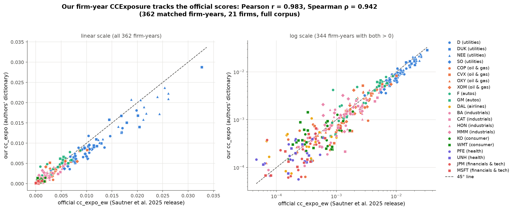
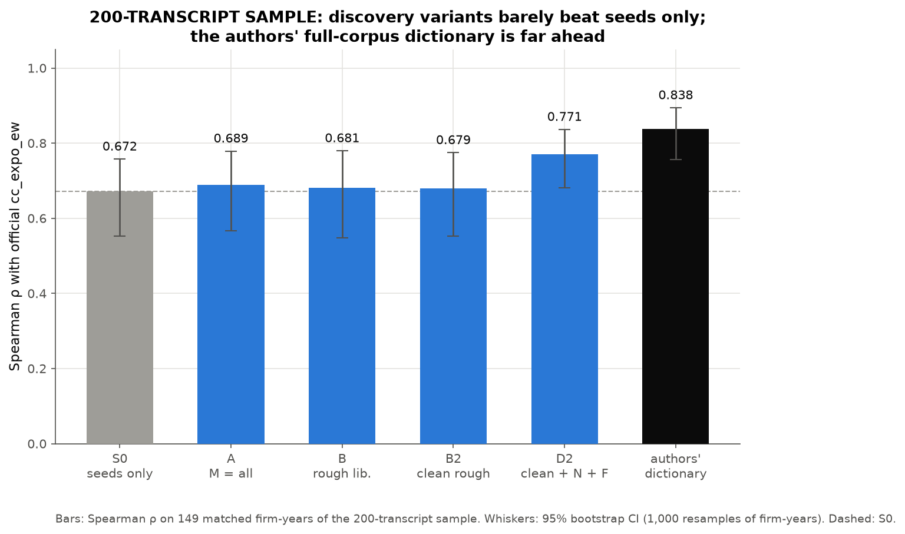
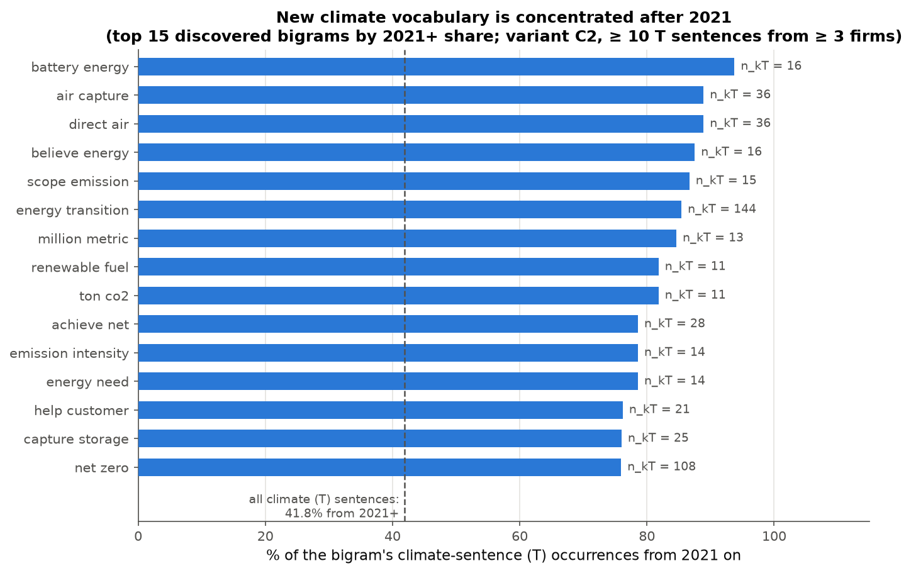
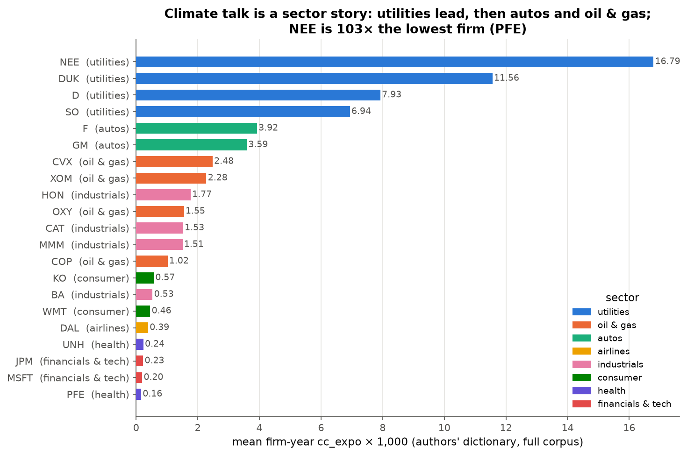
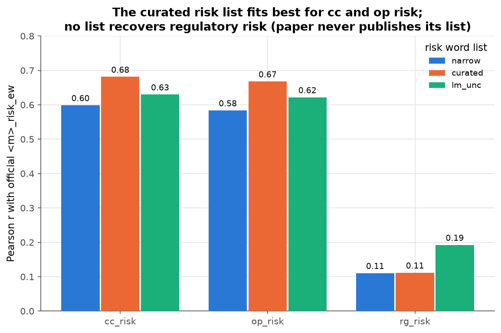
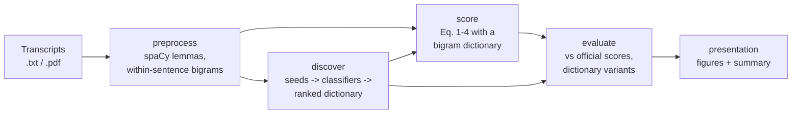

# Climate-exposure pipeline: Sautner et al. (2023) replication

This project rebuilds the firm-level climate change exposure measure of Sautner, van Lent,
Vilkov & Zhang (2023, *Journal of Finance*, "Firm-Level Climate Change Exposure") as one
reproducible pipeline. It does three things:

1. **Replication.** It scores earnings-call transcripts with the authors' published bigram
   dictionaries (exposure, sentiment and risk; paper Eq. 1–4) and compares the results with
   the official firm-year scores.
2. **Discovery re-implementation.** It re-implements the paper's keyword-discovery algorithm
   (50 seed bigrams → three classifiers → climate sentences → ranked bigram dictionary) and
   tests whether a dictionary discovered on our corpus beats the 50 seeds.
3. **Vocabulary shift.** It checks which climate bigrams have become central since 2021
   (net zero, carbon capture, energy security, …) but are missing from the authors' pre-2021
   dictionary.

**Corpus:** 1,508 earnings-call transcripts from 21 US firms, 2005–2026. 362 firm-years
(21 firms) match the official scores on (ISIN, year).

## Key results

The full summary is in [outputs/presentation/results_summary.md](outputs/presentation/results_summary.md).

- **Replication works.** With the authors' dictionary, our firm-year CCExposure correlates
  with the official scores at Pearson r = 0.983 / Spearman ρ = 0.942. The topic measures
  follow: opportunity 0.980 / 0.915, regulatory 0.891 / 0.847, physical 0.711 / 0.660
  (physical exposure is rare, so it is the noisiest).
- **ExxonMobil 2024 check:** CCExposure = 0.004575, 79.6% of the official 0.00575 (mean of 4
  quarterly transcripts). Our transcript texts are shorter than the authors', so levels
  run a little lower.
- **Risk:** the paper never publishes its risk word list. Of three candidate lists, the
  curated one fits best (cc_risk r = 0.681). None of them recovers regulatory or physical risk.
- **Discovery** (200-transcript sample, 149 matched firm-years, 21 firms). The classifiers
  do find climate-heavy sentences: they hold 27× more of the authors' bigrams per sentence
  than the rest of the corpus. Against the official scores, the 50 seeds alone give
  Spearman ρ = 0.672 and the authors' dictionary 0.838. Our best discovered dictionary (D2:
  cleaned IPCC library, normal-text filter, ≥3-firm filter; 106 bigrams) reaches 0.771. That
  is a gain of +0.099 over the seeds (95% bootstrap CI [+0.037, +0.172]), but it stays below
  the authors' dictionary. The larger discovered dictionaries do not beat the seeds
  significantly. Discovery needs corpus scale: the authors trained on about 60k climate
  sentences and we have about 2k.
- **Vocabulary shift:** 41.8% of climate sentences come from 2021 or later. Net zero, carbon
  capture, energy transition, direct air capture and scope emissions are central to recent
  calls but absent from the authors' (2021) dictionary.

## Figures

**Figure 1. Replication:** our CCExposure against the official scores, by firm-year.



**Figure 2. Seeds vs discovery:** Spearman ρ with the official scores and 95% bootstrap CIs, one point per dictionary variant.



**Figure 3. Vocabulary shift:** climate bigrams that are most concentrated in 2021+ calls.



**Figure 4. Exposure by industry:** mean firm CCExposure, coloured by sector.



**Figure 5. Risk word lists:** fit of three candidate risk lists against the official risk scores.



## Pipeline



All stages share one text cleaner ([src/preprocess.py](src/preprocess.py)). Each stage
reads from and writes to `cache/` (parquet), so any stage can be re-run on its own.

| Stage | What it does | Output |
|---|---|---|
| `preprocess` | read transcripts, split sentences, lemmatize | `cache/sentences.parquet` |
| `score` | exposure / sentiment / risk per transcript and firm-year (Eq. 1–4) | `outputs/scores_firmyear[_full].csv` |
| `check_xom` | score the ExxonMobil 2024 PDFs and compare with the official value | console |
| `compare_official` | correlations with the official scores (`--full` for the full corpus) | `outputs/compare_official[_full].csv` |
| `isin_gap` | list corpus tickers missing from `ticker_isin_map.json` | console |
| `rough` | IPCC "rough library" of climate bigrams minus normal-text bigrams | `cache/discovery/rough_bigrams.pkl` |
| `discover` | seeds → classifiers → climate sentences T → ranked dictionary | `outputs/discovered_bigrams.csv` |
| `discover_eval` | discovered dictionary vs the authors' | console / cache |
| `discover_variants` | runs every discovery variant (S0, A–D2) and compares them | `outputs/discovery_variants.csv`, `vocab_shift.csv`, `human_check_top100.csv` |
| `compare_dicts` | firm-year scores with the discovered vs the authors' dictionary | `outputs/compare_dicts.csv` |
| `presentation` | figures, tables and the results summary | `outputs/presentation/` |

## How to reproduce

Tested with Python 3.14 on Windows.

```bash
# 1. virtual environment
python -m venv .venv
.venv\Scripts\activate            # Windows  (Linux/macOS: source .venv/bin/activate)

# 2. dependencies
pip install -r requirements.txt
python -m spacy download en_core_web_sm
# NLTK sentence-tokenizer data is downloaded automatically on first run

# 3. data paths: edit climate_pipeline/config.yaml -> paths:
#    authors_dictionaries, transcript_dir, pdf_dir, official_scores
#    (see "Data not included" below)

# 4. run the stages (from climate_pipeline/)
cd climate_pipeline
python run.py --stage preprocess                # add --sample for a 200-transcript prototype
python run.py --stage score                     # full corpus; --sample for the prototype
python run.py --stage compare_official --full
python run.py --stage check_xom
python run.py --stage rough
python run.py --stage discover
python run.py --stage discover_eval
python run.py --stage discover_variants
python run.py --stage compare_dicts
python run.py --stage presentation
```

`--force` rebuilds cached files. Every setting (paths, sample size, seeds, discovery
variants, bootstrap size) is in [config.yaml](config.yaml); nothing is hard-coded.

## Tests

**75 tests, all passing** (about 70 s). Some tests read the external data and cached files
listed below.

```bash
python -m pytest climate_pipeline/tests -q      # from the repo root
```

## Deviations from the paper

- **Classifier:** LinearSVC with probability calibration instead of a kernel SVC.
- **Training sample:** ratio-matched. The S sample is 1.667 × |R|, the paper's 100k / 60k ratio.
- **Text cleaning:** no stemming, only spaCy lemmas. As a result the (unlemmatized)
  Loughran–McDonald sentiment words match a little less often. Sentiment tracks the
  official scores (r = 0.967) but runs lower (median ratio 0.71).
- **IPCC rough library:** AR5 (SYR, WG1, WG2 Part A, WG3) + SR1.5.
- **Normal text N:** the NLTK Gutenberg, Reuters and Brown corpora.
- **Rough-library cleaning:** we drop citation lines and digit tokens and apply token-validity filters.
- **Firm filter (our addition):** a candidate bigram must appear in climate sentences of at
  least 3 different firms. Without it, a 21-firm corpus surfaces executive names and firm jargon.
- **Risk word list:** it is not published, so we compare three candidates (narrow, curated, LM uncertainty).
- **Scale:** we have about 2k climate training sentences from 21 firms. The authors had about
  60k from the full earnings-call universe.

## Data not included

The repository contains code, configuration, tests, the five figures and the results
summary only. These inputs are external and **not in the repo** (licensing / size). Set
their locations in `config.yaml`:

- **Earnings-call transcripts** (`transcript_dir`, `.txt`; `pdf_dir`, ExxonMobil `.pdf`).
- **Authors' dictionaries** (`authors_dictionaries`, `.pkl` files from the paper's
  replication package, *Journal of Finance* supplementary material).
- **Official firm-year scores** (`official_scores`, the authors' published CSV, 2024Q4 version).
- IPCC report PDFs for the rough library (`data/ipcc/`).

All intermediate caches (`cache/`) and output CSVs are git-ignored or left untracked. They
are regenerated by the stages above.

## Next steps

- **Topic dictionaries:** discover opportunity, regulatory and physical dictionaries from the
  topic seeds (paper Table IA.IV).
- **Validation suite:** reproduce the paper's validation tests (Table VI).
- **India:** apply the same pipeline to Indian annual-report MD&A text extracted with
  [arpipe](https://github.com/hariom-s27/arpipe).
